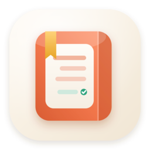
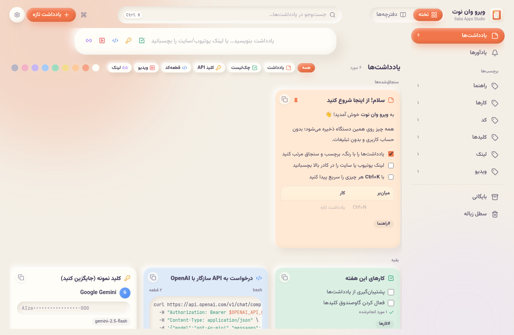
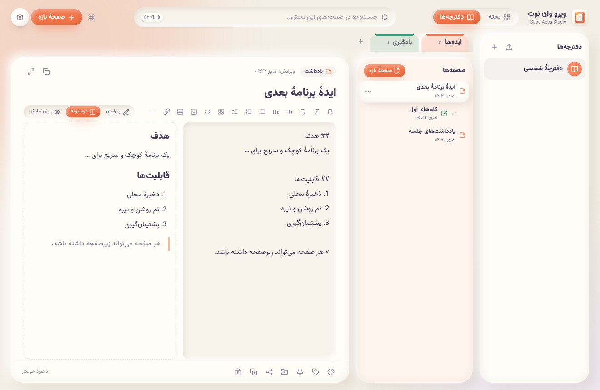
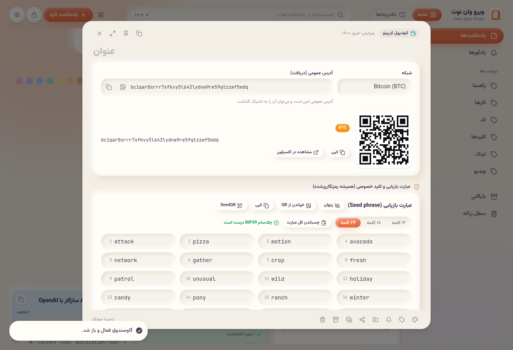
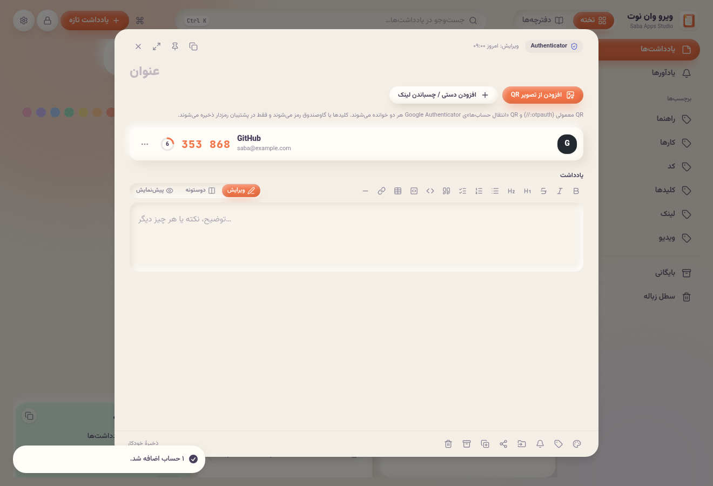
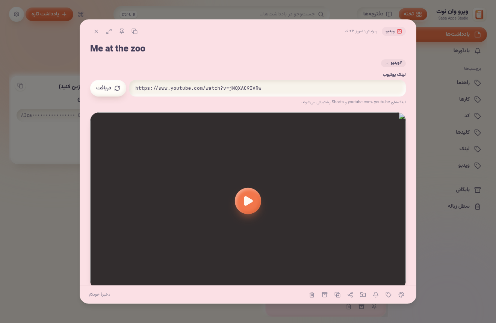
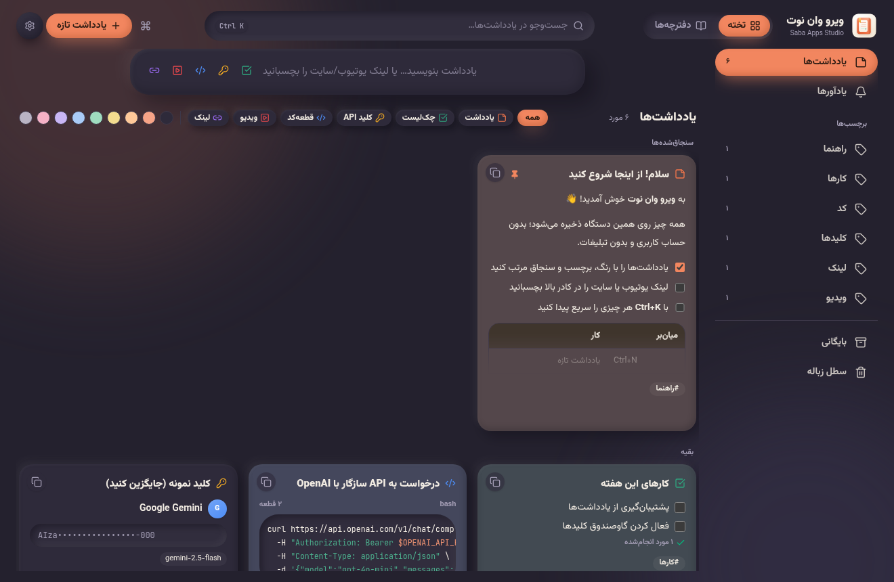

  

<h1 align="center">ویرو وان‌نوت</h1>

  <b>یادداشت، دفترچه و گاوصندوق شخصی شما؛ فارسی، رایگان و کاملاً روی دستگاه خودتان.</b> 
  ساختهٔ <b>Saba Apps Studio</b>

  <a href="../../releases/latest"><b>⬇️ دانلود آخرین نسخه برای ویندوز</b></a>

---

ویرو وان‌نوت سادگی Google Keep را با نظم OneNote یک‌جا دارد و برای فارسی‌زبان‌ها ساخته شده است: راست‌به‌چپ، فونت وزیرمتن، ارقام فارسی و تاریخ شمسی.
بدون تبلیغ و بدون حساب کاربری. یادداشت‌های شما هیچ‌وقت به سروری فرستاده نمی‌شوند.

  
  

## ✨ قابلیت‌ها

### 🗂️ تخته و دفترچه
- **تخته به سبک Keep:** کارت‌های رنگی، سنجاق، برچسب، بایگانی، سطل زباله، جست‌وجوی فوری و جابه‌جایی با کشیدن.
- **دفترچه به سبک OneNote:** دفترچه ← بخش‌های رنگی ← صفحه و زیرصفحه.
- **ویرایشگر مارک‌داون:** نوار ابزار، پیش‌نمایش زنده، چک‌لیست، جدول و بلوک کد رنگی.

### 🎬 یادداشت‌های ویژه
- **ویدیوی یوتیوب:** لینک را بچسبانید تا عنوان، کانال و تصویرش بیاید. پخش داخل برنامه، نشانک زمانی و علامت «دیده‌شده».
- **لینک:** عنوان و تصویر صفحه خودکار گرفته می‌شود.
- **قطعه‌کد:** چند قطعه در هر یادداشت، با رنگ‌آمیزی و کپی جداگانه.
- **کلید API:** برای OpenAI، Gemini، Anthropic و … در گاوصندوق رمزدار.

### 🔐 امنیت
- **قفل برنامه (اختیاری):** نام کاربری و رمز، رمزنگاری AES-256 کل داده‌ها روی دیسک، کلید بازیابی و قفل خودکار.
- **دفترچهٔ رمزدار:** هر دفترچه رمز جداگانهٔ خودش را دارد.
- **کیف‌پول کریپتو:** آدرس با QR و ذخیرهٔ امن عبارت بازیابی ۱۲ تا ۲۴ کلمه‌ای (BIP39 و SeedQR). همیشه رمزشده است و هیچ‌وقت در فایل اشتراکی نمی‌آید.
- **Authenticator:** کدهای دومرحله‌ای TOTP با اسکن QR و انتقال از Google Authenticator.

  
  
  

### 🔄 ورود، خروجی و پشتیبان
- **وارد کردن از OneNote** (خروجی ‎.docx، ‎.mht و ‎.html) و **Obsidian** (کل Vault با برچسب‌ها، ویکی‌لینک‌ها و تصاویر).
- **خروجی Obsidian** و همگام‌سازی یک‌طرفه با پوشهٔ Vault.
- **پشتیبان JSON** (با رمز، اگر بخواهید) و نسخه‌های خودکار داخل برنامه.
- **اشتراک‌گذاری** یادداشت، بخش یا دفترچه به‌صورت فایل ‎.viro یا مارک‌داون.

### 🎨 و بیشتر
- ۱۶ تم روشن و تیره، پالت فرمان `Ctrl+K`، حالت تمرکز، یادآور.

  

## ⬇️ نصب

از بخش [Releases](../../releases/latest) یکی از این دو فایل را بگیرید:

| فایل | توضیح |
| --- | --- |
| `ViroOneNote-<نسخه>-setup.exe` | نصب‌کننده (حدود ۳ مگابایت). اگر WebView2 نباشد، خودش آن را نصب می‌کند. |
| `ViroOneNote-<نسخه>-portable.exe` | نسخهٔ قابل‌حمل بدون نصب (حدود ۷ مگابایت). روی ویندوز ۱۰ و ۱۱ اجرا می‌شود. |

> فایل‌ها هنوز امضای دیجیتال ندارند، پس ممکن است ویندوز هشدار SmartScreen بدهد. روی **More info** و بعد **Run anyway** بزنید.

بار اول که برنامه را باز می‌کنید، لایسنس رایگان خودکار و بدون کلید فعال می‌شود (به اینترنت نیاز دارد). بعد از آن آفلاین هم کار می‌کند.

## 🛡️ حریم خصوصی
- همهٔ یادداشت‌ها فقط روی دستگاه خودتان ذخیره می‌شوند.
- برنامه فقط برای این کارها به اینترنت وصل می‌شود: گرفتن پیش‌نمایش لینک و یوتیوب، و فعال‌سازی و تمدید لایسنس رایگان (فقط یک شناسهٔ ناشناس دستگاه فرستاده می‌شود).
- کلیدهای API، عبارت‌های بازیابی و کدهای Authenticator هیچ‌وقت در فایل اشتراکی یا پشتیبان بدون رمز نمی‌آیند.

## ❤️ حمایت
ویرو وان‌نوت رایگان است. اگر به کارتان آمد، از دکمهٔ «حمایت از سازنده» داخل تنظیمات یا [بازوی بله](https://ble.ir/virolicensebot?start=donate) حمایت کنید.

## 📜 مجوز
این برنامه رایگان است، ولی کد آن متن‌باز نیست.
© Saba Apps Studio، همهٔ حقوق محفوظ است.

---

<b>English</b>

**Viro One Note** is a free, local-first notes app for Windows with a Persian (RTL) interface, made by Saba Apps Studio. It works like a Google Keep board and OneNote notebooks combined, with special note types for YouTube videos, links, code snippets, an encrypted API-key vault, a crypto wallet (address QR, BIP39 seed and SeedQR) and a TOTP authenticator. It also has an optional app lock with AES-256 at-rest encryption, per-notebook passwords, import from OneNote and Obsidian, Obsidian export, and backups. There are no ads and no accounts, and your data never leaves your device.

Download it from [Releases](../../releases/latest). Builds are unsigned, so SmartScreen may warn you: click More info, then Run anyway.

Free to use. Proprietary, all rights reserved © Saba Apps Studio.

**Development:** React 19, Vite, TypeScript, Tailwind v4, Dexie and Tauri 2. Run `npm install`, then `npm run dev`. Before each commit, run the quality gate: `npx tsc -b && npm test && npx eslint . && npx vite build`.

